# PromoAI: AI-assisted microdrama promo discovery

PromoAI reads a timestamped microdrama screenplay pack and finds the moments most likely to work as short promos: a 20-60 second stretch (one segment or several joined segments) that opens on a **hook within 3 seconds**, ends on an **unresolved cliffhanger**, and **makes sense to a viewer who has not seen the show**. A language model does the story understanding and proposes candidates as screenplay line IDs. Plain Python turns those IDs into exact timestamps, enforces every measurable rule, runs three independent judge votes on the subjective ones, removes duplicates and ranks the survivors.

> **Scope.** The system identifies **timestamped screenplay moments**. It does **not** generate or edit video, music or captions.

Built for the Kuku AI Generalist take-home, Problem 1 ("Find the Promos"). The two-page write-up is in [submission/Kuku_Solution_Document.pdf](submission/Kuku_Solution_Document.pdf) (editable source: [submission/Kuku_Solution_Document.md](submission/Kuku_Solution_Document.md)).

## Key results

One full run on the 50-episode pack (model `gemini-3.5-flash-lite`, run `run-v1-20261107T021608Z-713f`). Every figure below was read from that run's output files.

| Measure | Value |
|---|---|
| Episodes processed | 50 / 50 |
| Detection windows | 10 |
| Candidates requested / returned | 40 / 21 |
| Valid line references | 20 |
| Passed deterministic gates | 13 |
| Semantically judged (3 votes each) | 13 |
| Passed every semantic gate | 9 |
| **Ranked promos** | **9** |
| API calls | 39 (12 detection, 27 judge), 0 cache hits |
| Tokens | 364,975 input / 42,439 output |
| Invalid-JSON replies repaired by retry | 2 |
| Fatal failures | 0 |
| Automated tests | 469 passing |

Of the 21 returned candidates, 12 were rejected (5 too short, 1 too long, 1 that could not end within 2 s of its cliffhanger, 2 weak cliffhangers, 2 weak hooks, 1 exact duplicate). These numbers describe one run on one show. They are not a measure of promo quality; see [Evaluation and limitations](#evaluation-and-limitations).

## Features

All of the following is implemented and covered by the test suite.

- **Dynamic screenplay discovery and parsing.** The episode count is never hard-coded; a ZIP, a folder holding one ZIP, or a folder of `.txt` episode files is accepted. A coverage check shows that no parsed content was dropped.
- **Timestamp and source-line indexing.** Every line has a stable ID such as `E016-S01-L043`, integer-millisecond times, and a pointer back to its source file and line.
- **Running story context.** Each detection window updates a story summary (characters, conflicts, reveals, open questions) that is merged deterministically and passed to the next window.
- **LLM candidate detection.** The model returns line-ID ranges, a hook line and a cliffhanger line, never timestamps.
- **Deterministic timeline validation.** Duration (20-60 s), hook timing (3 s), cliffhanger tail (2 s by default), dialogue-boundary snapping and structural ID checks.
- **Hook, cliffhanger and standalone assessment.** A written rubric is applied to the final clip, with emotional pull, coherence and spoiler risk recorded for ranking.
- **Three independent judge votes** per clip, strict majority per gate, each vote preserved in the output.
- **Deduplication and ranking.** Exact and overlapping clips removed, per-episode and total caps, tiered ranking with documented tie-breaks.
- **Response caching and resumable execution.** Finished stages are checksum-verified and skipped on `--resume`.
- **Versioned run folders and preserved invalid raw replies.** Nothing is overwritten.
- **JSON and CSV outputs**, plus a human-readable report and a usage report.

## Architecture

```mermaid
flowchart LR
    A[Input: ZIP or folder] --> B[Parse and index<br/>Python]
    B --> C[Story context<br/>LLM per window,<br/>merged by Python]
    C --> D[Candidate detection<br/>LLM returns line IDs]
    D --> E[Timeline validation<br/>Python: exact times,<br/>duration, hook, boundaries]
    E --> F[Semantic judging<br/>LLM, 3 independent votes]
    F --> G[Majority vote,<br/>dedupe, ranking<br/>Python]
    G --> H[Reports<br/>JSON, CSV, Markdown]
    classDef py fill:#e6f6ea,stroke:#2f855a,color:#1a202c;
    classDef llm fill:#e3edfb,stroke:#2b6cb0,color:#1a202c;
    class B,E,G,A,H py;
    class C,D,F llm;
```



In `run.py` these run as five checkpointed stages: `01_parse`, `02_detect` (story context and detection), `03_timeline`, `04_semantic` (votes), `05_rank` (majority, dedupe, ranking, reports).

## Engineering decisions

- **The LLM returns line IDs, not timestamps.** Models invent plausible-looking times. IDs can be checked against the parsed screenplay, and Python maps them to exact times, so a hallucinated reference is caught and rejected instead of becoming a wrong clip.
- **Overlapping blocks are never summed.** Dialogue, camera, action and sound blocks run in parallel (54% of adjacent block pairs in the sample pack overlap in time), and timestamps restart in every episode. A segment's length is its earliest start to its latest end; a promo's length is the sum of its segments.
- **Code enforces duration, hook timing and dialogue boundaries.** In early samples the model marked clips as valid that measured 75.8 s, 69.0 s and 19.5 s, or whose hook came 13.0 s in. The model's own claims are stored as unverified and never decide a gate. Start and end snap to complete blocks, so a line is never cut in half.
- **Independent votes for subjective gates.** A single judge call can flip between identical runs. Each of the 3 votes is a separate API call (distinct cache salt), the strict majority decides, and the individual votes are kept. This steadies the judge; it does not remove disagreement (4 of 39 gate decisions in the full run were split votes).
- **Cache keys and run-specific salts.** The cache key is a hash of the provider fingerprint (provider, model, settings), an optional salt and the prompt, so changing the model or settings never replays old answers. Vote salts include the run folder name: a new run makes fresh vote calls, while `--resume` reuses finished votes. Stage records list artifact checksums and writes are atomic (temp file then rename), so a crash can leave a half-written stage but never a half-written result mistaken for a complete one.
- **Provider abstraction.** The rest of the code only knows `generate(prompt) -> str` (`promoai/llm.py`). Provider, model, key and temperatures come from configuration, and no provider-specific structured-output feature is used; replies are validated with Pydantic and retried once if invalid. Only a Gemini adapter (`promoai/llm_gemini.py`, standard-library REST, key sent in a header) is implemented. Adding another provider means one small class and one branch in `create_provider`; that has not been done or tested.

## Project structure

```
promoai/
├── README.md
├── run.py                 # end-to-end entry point (delegates to promoai/runner.py)
├── requirements.txt       # pydantic, pytest
├── pytest.ini
├── .env.example           # placeholders only; copy to .env
├── .gitignore
├── promoai/
│   ├── runner.py          # run.py logic: stages, run folders, resume, reports
│   ├── ingest.py          # find / safely extract / enumerate screenplay files
│   ├── parser.py          # tolerant line-oriented screenplay parser with coverage check
│   ├── models.py          # Episode / Scene / Line data structures
│   ├── timecode.py        # integer-millisecond timecode helpers
│   ├── index.py           # ID -> line lookup over parsed episodes
│   ├── pipeline.py        # parsing batch runner (also `python -m promoai.pipeline`)
│   ├── story.py           # running story context: deterministic merge and trimming
│   ├── prompts.py         # all prompt construction
│   ├── schemas.py         # Pydantic schemas for everything the LLM returns
│   ├── detect.py          # window loop: story context and candidate detection
│   ├── timeline.py        # ID -> exact times; deterministic quality gates; boundary snapping
│   ├── semantic.py        # rubric levels, pass/fail mapping, judge calls, vote aggregation
│   ├── ranking.py         # gates, dedupe, caps, tiered ranking
│   ├── validate.py        # standalone validation CLI and result records
│   ├── stability.py       # developer tool: judge repeatability experiment
│   ├── config.py          # .env / environment settings (API key never printed)
│   ├── llm.py             # provider interface, cache, validated generation, fake provider
│   └── llm_gemini.py      # Gemini REST adapter
├── tests/                 # 20 test files, all offline unless marked real_data
├── examples/sample_output/# synthetic examples of the output files
├── submission/            # Kuku solution document (PDF and Markdown source)
└── data/                  # git-ignored: input, extracted scripts, caches, run folders
```

`eval/` (private independent-evaluation material) also exists locally and is git-ignored.

## Setup and prerequisites

**Python.** Developed and tested on Python 3.14.3 (Windows). The minimum supported version has not been tested; use a recent Python 3. Dependencies are `pydantic>=2.12` (tested with 2.14.3) and `pytest>=8` for tests (tested with 9.2.0). The Gemini adapter uses only the standard library. The dependency set has been verified in the development virtual environment, not on a separate clean machine.

```bash
python -m venv .venv
# Windows PowerShell:  .venv\Scripts\Activate.ps1
# Windows cmd:         .venv\Scripts\activate.bat
# macOS / Linux:       source .venv/bin/activate
pip install -r requirements.txt
```

**Configuration.** Copy `.env.example` to `.env` and fill in the placeholders. Real environment variables override `.env`. Create a Gemini key at <https://aistudio.google.com/apikey>.

| Variable | Default | Meaning |
|---|---|---|
| `LLM_PROVIDER` | `gemini` | Provider name (only `gemini` is implemented). The key variable is `<PROVIDER>_API_KEY`. |
| `LLM_MODEL` | none, **required** | Model id. List the ones your key can use with `python -m promoai.llm --list-models`. |
| `GEMINI_API_KEY` | none, **required** | Your API key. Never commit it. |
| `LLM_TEMPERATURE` | `0.4` | Story notes and candidate detection. |
| `LLM_JUDGE_TEMPERATURE` | `0.0` | Semantic judge (also `--judge-temperature`). |
| `LLM_JUDGE_VOTES` | unset | Independent votes per clip; `run.py` uses 3 when unset (also `--judge-votes`). |
| `LLM_MAX_OUTPUT_TOKENS` | `8192` | Output cap per call. |
| `LLM_MIN_INTERVAL_SECONDS` | `6` | Minimum gap between calls (about 10 requests per minute). |
| `LLM_TIMEOUT_SECONDS` | `180` | Per-request timeout. |
| `LLM_MAX_TRANSPORT_RETRIES` | `3` | Retries on transport errors. |
| `LLM_CACHE_DIR` | `data/cache/llm` | Response cache location. |

## Running the project

Every real run calls the model API and uses your quota.

```bash
# Full run on a ZIP (the input pack is not part of this repository)
python run.py --input "path\to\screenplay.zip"

# A folder containing one ZIP, or a folder of episode .txt files
python run.py --input "path\to\folder"

# Limited run on the first 3 discovered episodes
python run.py --input "path\to\screenplay.zip" --max-episodes 3

# Different number of candidates requested per detection window (default 4)
python run.py --input "path\to\screenplay.zip" --candidates-per-window 6

# Resume a crashed run (same input, same provider/model settings)
python run.py --input "path\to\screenplay.zip" --resume "data\runs\<series>\run-v1-<timestamp>-<id>"

# All options
python run.py --help
```

Other options (all with defaults): `--window-size 6`, `--overlap 1`, `--eval-batch 5`, `--max-promos 10`, `--max-per-episode 2`, `--cliff-tail-max-s 2.0`, `--judge-temperature`, `--judge-votes`, `--runs-dir data/runs`. Each invocation creates a new run folder under `--runs-dir` and refuses to reuse one. A resume refuses if the input, provider, model or temperature changed.

**Tests** (offline; no API key and no network):

```bash
python -m pytest -q
```

469 tests pass in the development environment, which also holds the private screenplay pack. Three test modules exercise that pack and skip themselves when it is absent, so a checkout without the data will report fewer passes plus skips.

## Outputs

Each run writes a folder `data/runs/<series>/run-v1-<UTC timestamp>-<id>/`:

| File or folder | Contents |
|---|---|
| `ranked_promos.json` | Ranked promos: per-segment start/end (episode, timecode, line ID, source line), hook, cliffhanger, tiers, one-line justification, every gate result, the model's original unverified claims, and the sort key. |
| `ranked_promos.csv` | The same ranking as a flat table: rank, candidate, episodes, clip windows, duration, hook offset, tiers, justification, flags. |
| `rejected_candidates.json` | Every rejected candidate with the stage, gate and reason, plus rejection counts per gate and reason. |
| `report.md` | Human-readable run report: funnel, windows, top picks, ranking rule, rejections, usage, limitations. |
| `usage_report.json` | Provider, model, temperatures, votes, API calls, cache hits, retries, input/output tokens per stage and per episode, failures. |
| `run_config.json` | The command and every setting used (the API key is never written). |
| `stages/` and `state/` | Per-stage artifacts and the completion records (with artifact checksums) that make resume safe. |
| `raw_failures/` | Numbered raw model replies that failed validation, kept for diagnosis and never overwritten. |

The response cache lives separately in `data/cache/llm/` (hash-keyed model replies, not prompts).

A synthetic example of the file shapes, with no real screenplay content, is in [examples/sample_output/](examples/sample_output/).

## Evaluation and limitations

An **independent AI evaluation** (Claude, a different model family from the Gemini pipeline) re-rated 13 clips: the 9 ranked promos and 4 judge rejections, without seeing Gemini's verdicts. **This is not a human evaluation and not ground truth.**

| Gate | Pass/fail agreement with the pipeline |
|---|---|
| Hook | 11 / 13 |
| Cliffhanger | 11 / 13 |
| Standalone clarity | 12 / 13 |

Read these numbers with care:

- The 13 clips were hand-picked, and the evaluator was **not fully blind** (it had seen some of the pipeline's results earlier and could infer clip identities). Blindness was procedural only.
- Claude passed 13/13, 11/13 and 12/13 clips on the three gates, so a rule that passed everything would agree about as often. These are agreement counts, not accuracy, with no statistical significance.
- **Spoiler detection was weak.** Gemini rated all 13 clips as minor spoiler risk, including four ranked promos from episodes 45-50 that the evaluator rated High. The late-series guard only rejects a "major" rating, so it never triggered.
- **Semantic judgments can vary.** Voting steadies but does not remove run-to-run differences, and the judge treated similar openings and endings inconsistently.
- **Candidate discovery returned fewer than requested:** 21 of 40, with 6 of the 20 valid proposals breaking the length rule. Code rejects but never lengthens a clip.
- **Cross-episode joins were not exercised on real candidates.** The path is implemented and unit-tested, but none of the valid proposals in the full run crossed an episode boundary.
- One show, one run, one evaluator. A human review of the same clips is still needed.

## Scalability and future improvements

**Implemented**

- Episodes are discovered dynamically, nothing is fixed to 50, and detection runs in overlapping windows.
- Responses are cached; runs resume from checksummed stage records; each run is a new versioned folder.
- The provider and model are configuration, behind one `generate` interface.
- Cost is reported in tokens only: about 8,148 per episode in the full run (7,300 input, 849 output). No monetary figure is given because it depends on the model and current pricing.

**Proposed, not built**

- Run judge batches and votes in parallel up to the provider's rate limit. Detection windows are chained through the story summary, so that part would scale by processing shows or chunks in parallel.
- Mandatory human review for split-vote and late-series candidates before anything is posted.
- Better candidate recall (21 of 40 requested came back) and a spoiler check that names the specific reveal a clip contains.
- A second judge from a different model family for borderline clips, and a human-labelled sample to measure real accuracy.
- A second provider adapter.

## Security and data handling

- API keys live in `.env` (or the environment). `.env` is excluded from Git, `.env.example` holds placeholders only, and the key is sent in a request header and never printed or written to run files.
- Prompts and model replies contain screenplay text, so they are never logged and the cache stores only hashed keys and responses in a git-ignored folder.
- The screenplay pack, extracted scripts, parsed episodes, caches and run folders are excluded from Git (`data/`).
- Private evaluation excerpts and answer keys (`eval/`) are excluded from Git.
- **Raw run outputs are confidential.** `ranked_promos.json` and the stage folders contain screenplay text (hook and cliffhanger lines, parsed episodes, source file names), and a run folder also stores a copy of the input archive. Share a run folder only with parties entitled to the source material, never in a public repository.
- No dialogue from the source material appears in this README, the solution document or the sample output.
